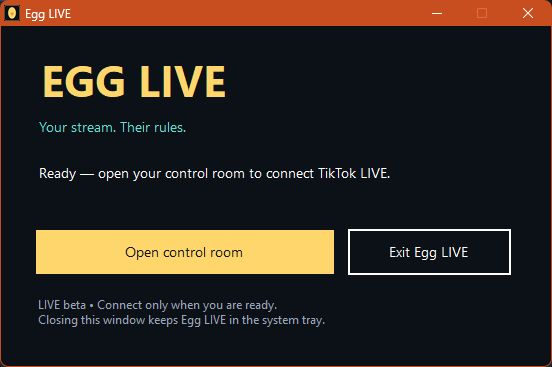
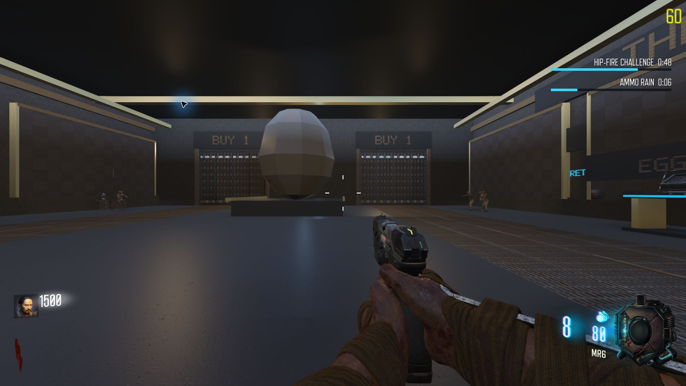

# Egg LIVE

## Get started — two downloads

### 1. Subscribe to the BO3 mod
[**Open Egg LIVE on Steam Workshop →**](https://steamcommunity.com/sharedfiles/filedetails/?id=3826163025)

Click **Subscribe**, then let Steam finish downloading.

### 2. Download the companion
[**Download Egg LIVE for Windows →**](https://github.com/callmetheeggmaan/egg-live/releases/download/v0.3.1-beta.1/Egg-LIVE-Windows.zip)

Extract the whole ZIP, then double-click **Egg LIVE.exe**. Keep the `app` folder beside it. Node/Python are included; you do not need to install them.

**You need both the Workshop mod and the companion.** The mod handles effects inside BO3; the companion receives gifts and lets you choose what they do.

## Go LIVE

1. Open **Egg LIVE.exe**. In the control room, enter your TikTok username and BO3 folder, then save.
2. With BO3 closed, click **Open BO3 with the mod** and enter a solo/private Zombies match.
3. Pick gift pictures, choose their effects, and save your actions.
4. Start your TikTok LIVE, then click **Connect TikTok LIVE** when you are ready. Return focus to BO3.

Use **Pause all actions** whenever you need to stop effects. Trigger volume and mute are above the gift grid. Closing the launcher window keeps it in the system tray; **Exit Egg LIVE** stops a companion started by that launcher.

## LIVE beta status

Real TikTok connectivity is **enabled**. Nothing connects automatically at startup, and the player release has no fake gift/test buttons.

**The first real LIVE gift end-to-end verification is still pending.** This is a LIVE-enabled beta, not a fully validated production release. Connection availability depends on the unofficial TikTok connector and can change.

43 automated checks and 18 isolated in-game checks passed; the compiled launcher started successfully using bundled runtimes with LIVE enabled and disconnected. The Workshop download was verified on the development PC. Independent clean-PC testing remains pending.

## Timers and gift streaks

Timed gifts add to the remaining duration of the same effect. For example, 5 Roses at 10 seconds per gift add 50 seconds, within your rule's combo limit. Stable gift streaks update as counts arrive; duplicate/final frames do not count twice. Without a stable combo ID, the connector waits for the final frame.

Each active effect has a compact countdown and shrinking bar on the right. Additional effects stack underneath; new gifts refill the matching bar. Opposing movement speeds replace one another. Timers cap at 60 minutes remaining.

The mod connects at the setup hub before difficulty selection. Gameplay effects wait for an active player, a fresh game signal and BO3 focus. Notifications show the viewer's username, gift and effect sequentially; effects do not wait for the presentation queue.

The local simulated three-gift bridge check applied in421–766ms after queueing. This excludes TikTok network delay and does not verify real paid-gift delivery end to end. The room catalogue uses 728 preloaded gifts and makes no optional paid room-list request.

## Requirements and limits

- Windows x64, a Steam copy of BO3, and an owned Zombies map.
- Host/solo/private Zombies only; one gameplay mod at a time.
- +50 zombies obeys native actor/space limits and cannot promise 50 simultaneous or instant spawns. Nearby spawns reject dog rounds.
- Perks, powerups and custom-map effects depend on the map's assets/scripts.
- F10 is reserved for the foreground-only local game bridge.

Your profiles stay on your PC in `%LocalAppData%\Egg LIVE`. Existing preview users can export their profile and import it into the new control room. Your personal settings and logs are not included in downloads.

The launcher is currently unsigned. A launcher makes installation simpler; it does not make the program's files secret or uneditable.

For developers: source, builds and licenses

Normal players only need the Windows download above and a Workshop subscription. They do not need to download this repository or the source code.

Developer source is available in this repository and the release's developer assets. See `launcher/BUILD.txt`, `BUILDING.txt`, `LICENSE`, `THIRD-PARTY.txt` and the pinned `companion/package-lock.json`.

Egg LIVE is AGPL-3.0-or-later; dependencies retain their own licenses. Tests remain in developer source for maintenance and are omitted from the Windows player package.

Unofficial; not affiliated with TikTok/ByteDance, Activision, Treyarch or Valve.

